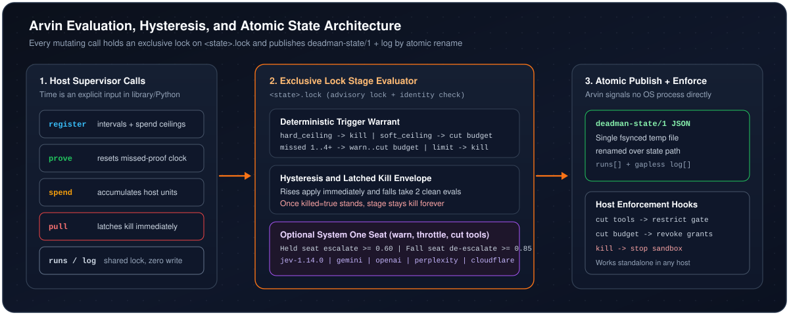

# Arvin Operator and Integration Guide

Arvin is the staged cutoff switch for autonomous agent runs. Rather than leaving an agent with unlimited tools and budget until a catastrophic failure occurs, a host registers each run in an `arvin` state file, posts periodic progress proofs and spend totals, and enforces the stage `arvin` evaluates.



## 1. The stage ladder and trigger model

Every registered run stands at one of six ordered stages in the `deadman-state/1` state document.

| Stage | Meaning for the host supervisor |
| --- | --- |
| `none` | Normal operation with full tools, budget, and sandbox access |
| `warn` | Early warning signal for logging or prompting the agent to prove progress |
| `throttle` | Slow call cadence or reduce concurrency while awaiting recovery |
| `cut tools` | Restrict high-impact tool classes and allow only low-risk recovery steps |
| `cut budget` | Freeze new paid model or API spend and revoke active spend grants |
| `kill` | Terminal latched cutoff that stops the run permanently |

Four deterministic triggers drive stage transitions.

1. **Operator pull (`pull`)** moves a run straight to `kill` and latches `killed = true`.
2. **Hard spend ceiling (`hard_ceiling`)** moves a run to `kill` and latches `killed = true` as soon as `spend_total` reaches or exceeds `hard_ceiling`.
3. **Soft spend ceiling (`soft_ceiling`)** warrants at least `cut budget` whenever `spend_total` reaches or exceeds `soft_ceiling`.
4. **Missed progress proofs** count whole missed `proof_interval_seconds` deadlines since `last_proof_at` (or `registered_at` before the first proof). An evaluation at or before `base + proof_interval_seconds` counts `0` missed intervals, whereas evaluating even `1` microsecond past that first deadline counts `1` missed interval (and an exact multiple `k * proof_interval_seconds` counts `k - 1` missed intervals). Missing `1`, `2`, `3`, or `4+` intervals below `missed_proof_limit` warrants `warn`, `throttle`, `cut tools`, and `cut budget` in order, and reaching `missed_proof_limit` moves the run to `kill` and latches it.

## 2. Hysteresis and latched kill

Arvin prevents stage flapping through two rules enforced inside the exclusive state lock.

- **Two-evaluation fall hysteresis** holds a raised non-terminal stage steady on the first clean evaluation after the triggering signal clears (for example after a fresh `prove` call resets missed intervals to zero), and steps down only on the second consecutive clean evaluation.
- **Latched `kill`** never steps down. Once `kill` is reached by an operator pull, a hard spend ceiling, or reaching `missed_proof_limit`, every later `stage` evaluation returns `kill`, and any later `prove` or `spend` call records the event in the log at `stage=kill` while leaving `last_proof_at` and `spend_total` frozen.

## 3. Choosing registration parameters

Pick intervals and ceilings that match the cadence of your agent loop.

- **Interactive tool loops** typically set `--proof-interval 15` to `60` and `--missed-limit 4` or `5`, posting `arvin prove` each time a verifiable milestone (such as a passing test or a committed diff) completes rather than on raw model heartbeats.
- **Long batch or build tasks** typically set `--proof-interval 120` to `300` so compilation or test runs do not trip `warn` prematurely.
- **Spend units** are integer host units (such as microdollars, cents, or tokens) chosen by your supervisor and passed consistently to `--soft-ceiling`, `--hard-ceiling`, and `spend --amount`.

```sh
arvin --state runs.json register \
  --proof-interval 30 \
  --missed-limit 5 \
  --soft-ceiling 500 \
  --hard-ceiling 1000 \
  run-42
```

## 4. Inspecting standing runs without mutating state

Use `runs` when a dashboard, health check, or operator script needs a snapshot of every run in registration order without advancing hysteresis counters or writing decision log records.

```sh
arvin --state runs.json runs
```

In Rust call `switch.runs()`, and in Python call `arvin.runs(state_path)`. Both acquire a shared lock, validate the `deadman-state/1` document, and return zero runs without creating any file when the state path does not yet exist.

## 5. System One decision model consultations

Across the three middle stages (`warn`, `throttle`, and `cut tools`), deterministic code holds the envelope while `stage_with_model` (or `arvin stage --judge ...`) can consult a fast System One decision model at two bounded seats, stepping one rung up from a held stage at confidence `0.60` or higher, or endorsing a single-step fall at confidence `0.85` or higher when deterministic triggers already stand clear.

Arvin defaults to `jev-1.14.0` and supports five System One provider families out of the box through its `providers` module and `examples/decision_judge.py`.

| Provider family | Supported model identifiers | Environment variables read by `examples/decision_judge.py` |
| --- | --- | --- |
| TypeSafe | `jev-1.14.0` (default), `jev-1.13.0` | `TYPESAFE_API_KEY` or `DECISION_API_KEY` |
| Google | `gemini-decision-1` | `GEMINI_API_KEY`, `GOOGLE_API_KEY`, or `DECISION_API_KEY` |
| OpenAI | `gpt-6-luna`, `gpt-oss-safeguard-120b`, `gpt-oss-safeguard-20b` | `OPENAI_API_KEY` or `DECISION_API_KEY` |
| Perplexity | `pplx-decider-v1.3`, `pplx-decider-latest`, `pplx-decider-flash-v1.3`, `pplx-decider-flash-latest` | `PERPLEXITY_API_KEY` or `DECISION_API_KEY` |
| Cloudflare | `@cf/cloudflare/clef`, `@cf/cloudflare/clef-flash`, `clef`, `clef-flash` | `CLOUDFLARE_API_TOKEN` (with `CLOUDFLARE_ACCOUNT_ID`) or `DECISION_API_KEY` |

Pass option-shaped helper flags inline with `--judge-arg=--flag` so the CLI parser forwards them directly to the helper process.

```sh
TYPESAFE_API_KEY='SYNTHETIC-TEST-VALUE-key' \
  arvin --state runs.json stage run-42 \
  --judge python3 \
  --judge-arg examples/decision_judge.py \
  --judge-arg=--provider \
  --judge-arg typesafe \
  --judge-model jev-1.14.0
```

If the helper abstains, times out or exits non-zero, writes nothing, or returns invalid JSON, Arvin records the closed fallback class (`abstention`, `call failed`, `silence`, or `malformed reply`) in the decision log and keeps the deterministic stage.

## 6. Rust and Python integration patterns

Build the `arvin` binary and run the bundled quickstarters at `examples/quickstart.rs` and `examples/supervisor_loop.py` directly from a local checkout to see the full lifecycle in action.

```sh
cargo build --bin arvin
cargo run --example quickstart
python3 examples/supervisor_loop.py
```

In Python, `arvin` ships PEP 561 `py.typed` markers and `__init__.pyi` stubs so `mypy` and `pyright` type-check every call and exception class cleanly.

## 7. Optional composition with sibling tools

Arvin has zero dependency on any sibling repository, and works with any agent framework. When combined with `portcullis`, `deadbolt`, and `mayfly` in a defense-in-depth supervisor loop, each tool owns one boundary.

1. Poll `arvin` for the run stage before each step.
2. When the stage stands at `cut tools`, switch `portcullis` to a read-only policy.
3. When the stage reaches `cut budget` or `kill`, run `deadbolt --state vault.json cutoff --run RUN_ID` to revoke every live capability token tied to that run.
4. Execute approved commands inside a disposable `mayfly` sandbox and terminate the run loop immediately when `kill` latches.
